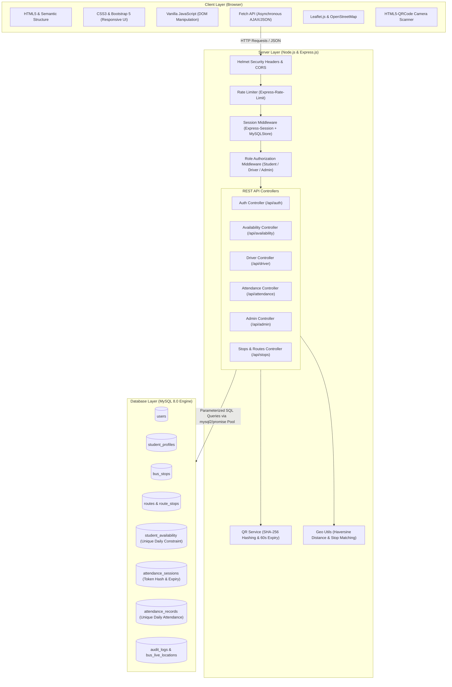

# SmartRoute — System Architecture Document

## 1. System Overview

**SmartRoute** is an intelligent, database-backed web application designed for college bus transit optimization, daily student availability declaration, driver route guidance, and dynamic QR-code-based boarding attendance verification.

The application has been completely migrated and rebuilt from a legacy Python Flask / SQLite prototype to a production-grade **Node.js, Express.js, and MySQL 8.0** technology stack, adhering strictly to modern Web Development course standards.

---

## 2. Architecture Diagram

---

## 3. Layered Design Breakdown

### 3.1 Presentation Layer (Frontend)
- **HTML5**: Semantic tags (`<main>`, `<aside>`, `<nav>`, `<header>`, `<section>`, `<table>`, `<form>`).
- **CSS3 & Bootstrap 5**: Custom styling variables (`--navy`, `--teal`, `--amber`, `--surface`), responsive CSS Grid and Flexbox layouts, accessible cards, and notification alerts.
- **Client-Side JavaScript**: Asynchronous communication through `fetch()` with credentials, dynamic DOM updates without full page reloads, Leaflet.js interactive maps with custom marker pins, and HTML5 camera QR code scanning via `html5-qrcode`.

### 3.2 Application & Business Logic Layer (Node.js & Express.js)
- **Modular Directory Architecture**:
  - `controllers/`: Request handling, parameter extraction, and business logic execution.
  - `routes/`: RESTful URL path mappings and HTTP method routing.
  - `middleware/`: Session authentication checks, role enforcement (`requireRole`), and IP rate limiting.
  - `services/`: Cryptographic operations (`crypto`), token hashing, and QR generation (`qrcode`).
  - `utils/`: Coordinate distance math (Haversine formula) and nearest bus stop calculation.
  - `config/`: MySQL connection pool configuration with `mysql2/promise`.

### 3.3 Data Layer (MySQL 8.0 Relational Database)
- **Storage Engine**: InnoDB supporting ACID transactions, row-level locking, foreign key constraints (`ON DELETE CASCADE`, `ON DELETE SET NULL`), and multi-column unique constraints.
- **Connection Management**: 10-connection pooled reuse preventing connection exhaustion.
- **SQL Injection Prevention**: 100% parameterized queries using prepared statements (`?` placeholders).

---

## 4. Key Workflows & Data Flows

### 4.1 Daily Student Availability Declaration
1. Student logs in and selects either "Taking the Bus (YES)" or "Not Coming (NO)".
2. If YES, the student selects a scheduled pickup stop or clicks "Use My GPS Location".
3. The frontend calculates or matches the nearest bus stop using geographic coordinates.
4. The client submits a JSON payload to `POST /api/availability`.
5. The backend validates the stop, checks student authorization, and executes an `INSERT ... ON DUPLICATE KEY UPDATE` query, guaranteeing at most one availability entry per student per date.

### 4.2 Driver Guidance & Skip Optimization
1. The driver logs into the driver console.
2. The driver console queries `GET /api/driver/dashboard`.
3. The backend calculates:
   - Total students marked YES vs NO for today.
   - For every stop on the assigned route: the exact count of waiting students.
   - Identifies empty stops (0 waiting students) that can be safely skipped to reduce travel time.
4. The frontend renders the stop list with visual badges ("Pickup" vs "SKIP") and displays markers on the interactive Leaflet map.

### 4.3 Dynamic 60-Second QR Boarding Attendance
1. Driver clicks "Generate Attendance QR".
2. The driver client invokes `POST /api/attendance/sessions`.
3. The server generates a 32-byte cryptographic random token, stores its SHA-256 hash in `attendance_sessions` with an expiration timestamp set to `NOW() + 60 seconds`.
4. The server returns a base64 Data URL QR code to the driver screen with a 60-second visual countdown.
5. A student boards the bus, clicks "Start Camera Scanner", and scans the QR code.
6. The student client sends the token to `POST /api/attendance/scan`.
7. The server hashes the submitted token and verifies:
   - Token exists in active sessions.
   - `expires_at > CURRENT_TIMESTAMP` (server-enforced expiration).
   - Session date matches today.
   - Student has not already marked attendance today (`uq_student_daily_attendance` constraint).
8. If valid, an attendance record is created with a server-generated timestamp.
