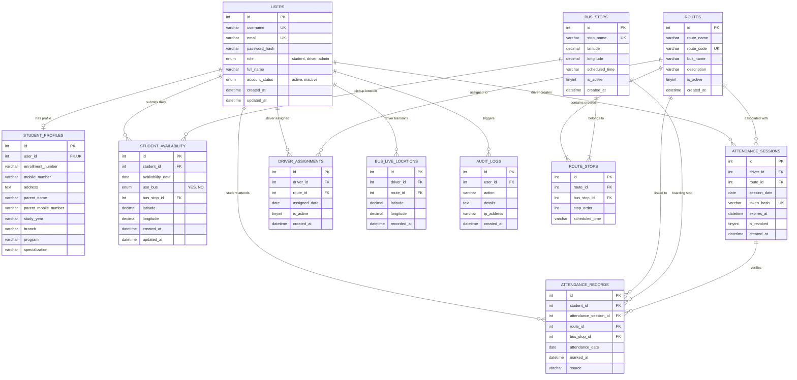

# SmartRoute — Database Design & ER Diagram

## 1. Overview

The SmartRoute database is built on **MySQL 8.0** using the **InnoDB storage engine**. The relational schema is normalized to **Third Normal Form (3NF)** to eliminate redundancy, ensure data consistency, and enforce referential integrity across users, routes, bus stops, availability, and attendance records.

---

## 2. Entity-Relationship (ER) Diagram

---

## 3. Relational Table Definitions & Constraints

### 3.1 `users`
Stores user identities, login credentials, and roles.
- **Primary Key**: `id` (Auto-increment)
- **Unique Keys**: `username`, `email`
- **Fields**: `password_hash` (bcrypt), `role` (`student`, `driver`, `admin`), `account_status` (`active`, `inactive`).

### 3.2 `student_profiles`
Maintains extended student details without polluting the core authentication table.
- **Primary Key**: `id`
- **Foreign Key**: `user_id` &rarr; `users(id)` (`ON DELETE CASCADE`, `UNIQUE`)
- **Fields**: `enrollment_number`, `mobile_number`, `parent_name`, `parent_mobile_number`, `address`, `study_year`, `branch`, `program`, `specialization`.

### 3.3 `bus_stops`
Maintains designated transit stops across the college route.
- **Primary Key**: `id`
- **Unique Key**: `stop_name`
- **Fields**: `latitude DECIMAL(10, 7)`, `longitude DECIMAL(10, 7)`, `scheduled_time`, `is_active`.

### 3.4 `routes` and `route_stops`
Models route definition and sequential ordering of stops along a bus route.
- **`routes` Primary Key**: `id`, Unique Key: `route_code`.
- **`route_stops` Constraints**:
  - Foreign Key: `route_id` &rarr; `routes(id)`
  - Foreign Key: `bus_stop_id` &rarr; `bus_stops(id)`
  - Unique Constraint: `uq_route_stop_order(route_id, stop_order)` (guarantees strict linear ordering)
  - Unique Constraint: `uq_route_stop(route_id, bus_stop_id)` (prevents duplicate stops within a route).

### 3.5 `student_availability`
Stores daily bus availability declarations made by students each morning.
- **Primary Key**: `id`
- **Foreign Keys**: `student_id` &rarr; `users(id)`, `bus_stop_id` &rarr; `bus_stops(id)`
- **Unique Constraint**: `uq_student_daily_avail(student_id, availability_date)`
  - **Crucial Integrity Rule**: Enforces that each student can submit at most one availability entry per day. Any update cleanly modifies the existing day record using `ON DUPLICATE KEY UPDATE`.

### 3.6 `attendance_sessions`
Tracks driver-generated live QR attendance sessions.
- **Primary Key**: `id`
- **Foreign Keys**: `driver_id` &rarr; `users(id)`, `route_id` &rarr; `routes(id)`
- **Unique Key**: `token_hash` (SHA-256 hash of the 32-byte cryptographic token)
- **Fields**: `expires_at DATETIME` (set to `NOW() + 60 seconds`), `is_revoked TINYINT(1)`.

### 3.7 `attendance_records`
Stores verified student boarding attendance entries.
- **Primary Key**: `id`
- **Foreign Keys**: `student_id` &rarr; `users(id)`, `attendance_session_id` &rarr; `attendance_sessions(id)`
- **Unique Constraint**: `uq_student_daily_attendance(student_id, attendance_date)`
  - **Anti-Fraud Rule**: Prevents students from scanning the QR code more than once per day.

---

## 4. Normalization and Performance

1. **Third Normal Form (3NF)**:
   - Every non-key column depends solely on the primary key, eliminating transitive dependencies.
   - Student academic and personal data is partitioned into `student_profiles`, leaving `users` lean for authentication lookups.
2. **Indexing Strategy**:
   - Indexes on foreign keys and frequently queried fields: `idx_user_role`, `idx_avail_date`, `idx_session_token_hash`, `idx_session_expires`, `idx_att_date`.
3. **Parameterization**:
   - Every database interaction is executed using prepared statements (`mysql2/promise` pool), mitigating 100% of SQL injection vulnerabilities.
